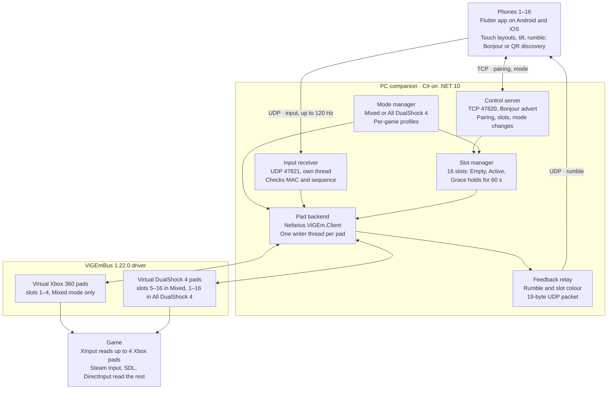

# PadLink — Phone-as-Controller App Design Document (Two Controller Modes)

*Last updated: 18 October 2026*

## Overview

PadLink (working name) turns Android and iOS phones into game controllers for one Windows PC over local Wi-Fi. It removes the 4-player cap found in Monect-style apps: v1 supports 8 players, and the design scales to 16. The host chooses between two controller modes, **Mixed** (4 Xbox + DualShock 4) and **All DualShock 4**, and can switch at any time.

**Goals**

- 8 simultaneous players in v1, with no architectural change needed to reach 16.
- The host picks the controller mode that suits each game, and PadLink can remember that choice per game.
- Feels like a wired pad: median phone-to-game latency under 15 ms on 5 GHz Wi-Fi.
- One mobile codebase that ships to both Google Play and the App Store.
- Join in under 10 seconds: auto-discovery on the network, QR code as fallback.
- Each player sees their slot (Player 1–8), their pad type, and gets rumble feedback on their phone.

**Non-goals for v1**

- Monect's other remote features (mouse, keyboard, media keys, screen mirroring).
- macOS or Linux PCs. The virtual controller drivers are Windows-only.
- Play over the internet. LAN only.
- Bluetooth transport.

**Success criteria**

- 8 phones drive 8 players in a 60-minute session of a test game, in each mode, with zero dropped controllers.
- Switching modes reconnects all pads within 2 seconds, with every player keeping their slot.
- p95 latency under 25 ms with 8 phones on one 5 GHz access point.
- Phone battery drain under 10% per hour with the screen on.

## Background: why 4 is the usual limit

Monect-style apps stop at 4 players because they emulate Xbox 360 pads, and Windows' XInput API exposes at most 4 of them. Both PadLink modes get past this by giving players 5 and up DualShock 4 pads, which that cap does not apply to.

- XInput supports a maximum of 4 controllers, a limit carried over from the Xbox ([Allegro.cc thread](https://www.allegro.cc/forums/thread/618290)).
- More than 4 virtual Xbox pads can exist, but games that use XInput only detect the first 4. DualShock 4 and DirectInput virtual pads are not subject to that limit ([PadForge wiki](https://github.com/hifihedgehog/PadForge/wiki/Controller-Slots/9af9073d05147963caf343c0c0f5944cb7b12711)).
- The ViGEmBus driver supports up to 16 virtual Xbox 360 pads and up to 16 DualShock 4 pads ([PadForge wiki](https://github.com/hifihedgehog/PadForge/wiki/Controller-Slots/5435ef44fb73cfd2d2eb1c12fb23fa8b147dc156)).
- Steam Input tops out at 16 controllers and also sees only 4 XInput pads ([Allegro.cc thread](https://www.allegro.cc/forums/thread/618290)).

The game is the final gate. Players 5+ only work in games that read controllers through DirectInput, SDL, raw HID or Steam Input.

Monect is closed-source, so PadLink is a new app built from scratch. It reuses no Monect code, assets, name or layout.

## Controller modes

The host picks one of two modes. Mixed is the safer choice for unknown or non-Steam games; All DualShock 4 is the better choice for Steam games with Steam Input, because every player is identical.

| | Mixed (4 Xbox + DualShock 4) | All DualShock 4 |
| --- | --- | --- |
| Pads created | Xbox 360 for slots 1–4; DualShock 4 for slots 5–16 | DualShock 4 for every slot |
| Games that read only XInput | Players 1–4 work | No players work unless Steam Input converts the pads |
| Steam Input games | Every player works; the 4 Xbox pads stay within Steam Input's 4-XInput limit | Every player works, up to 16 |
| Button prompts in game | Xbox for players 1–4, PlayStation for 5+ | PlayStation for everyone |
| Main risk | A game that reads both input APIs badly may show doubled or missing players | A game without DualShock 4 support sees a generic joystick or nothing |
| Best for | Unknown games, non-Steam games, mixed libraries | Steam games with Steam Input and PlayStation Configuration Support on |

On the duplicate-player risk: frameworks that read both APIs usually filter all XInput pads out of their DirectInput list to avoid duplicates ([itch.io developer thread](https://itch.io/post/511622)), but a badly built game may not.

**How the host chooses**

1. **First run** — the PC app shows a mode picker with the comparison above in two plain sentences. Mixed is pre-selected as the safe choice, with the hint "Use All DualShock 4 if your games use Steam Input."
2. **Any time** — a mode switch sits in the main window header, always visible.
3. **Per game** (M3) — the host can save a mode for a game by its executable name. When that game's process starts, PadLink switches to the saved mode if it differs, before the game scans for controllers.

Only the host (the PC app) sets the mode. Phones show the current mode and their own pad type, but cannot change it.

**What happens on a switch**

1. If a game is running, the PC app asks for confirmation: "Controllers will disconnect for about a second. Some games only detect controllers at launch."
2. Every pad gets a neutral report, so no button sticks.
3. All virtual pads are unplugged.
4. New pads are plugged in slot order: in Mixed mode, Xbox 360 for slots 1–4 first, then DualShock 4.
5. Each phone receives `slot_changed` with its new pad type and swaps its button labels.
6. Slot numbers, colours and pairings do not change.

Many games only scan for controllers at launch or in menus, so the help screen advises switching before starting a game.

## Requirements

v1 must connect 8 phones to one Windows PC with wired-pad feel, in either mode; every limit is set so 16 works later without a redesign.

**Functional**

1. Find PCs on the LAN automatically (Bonjour/mDNS), with QR code and manual IP as fallbacks.
2. Pair a phone once with a 6-digit code shown on the PC; remember it after that.
3. Accept up to 16 phones per PC; v1 is tested and supported at 8.
4. Give each phone the lowest free player slot. The host can reorder, swap or kick players.
5. Let the host choose Mixed or All DualShock 4 at first run and switch at any time.
6. Keep every player's slot, colour and pairing through a mode switch; reconnect all pads within 2 s.
7. Remember a mode per game and switch automatically when that game starts (M3).
8. Show each player their pad type on the phone, with matching button labels (A/B/X/Y or Cross/Circle/Square/Triangle).
9. Ship 3 built-in layouts — Standard, Retro (D-pad + 4 buttons), Racing (tilt steering + pedals) — plus a custom layout editor.
10. Pass game rumble back to the phone as vibration.
11. Show each player their number and colour on the phone.
12. Keep a player's slot for 60 s after a drop so a reconnect lands in the same slot.
13. Show per-slot latency, packet loss, pad type and phone battery on the PC.

**Non-functional**

| Requirement | Target |
| --- | --- |
| Players per PC | 8 in v1, 16 in v2 |
| Phone-to-virtual-pad latency, p50 / p95 | ≤ 15 ms / ≤ 25 ms on 5 GHz Wi-Fi |
| Mode switch time | All pads back within 2 s |
| Input send rate | On every change, capped at 120 Hz; 20 Hz keepalive when idle |
| Packet loss tolerated | Up to 5% with no stuck buttons |
| Bandwidth | About 7 KB/s per phone at 120 Hz; about 112 KB/s for 16 phones |
| PC CPU use | Under 2% of one core at 16 players |
| Phone battery drain | Under 10% per hour, screen on |
| Time to join | Under 10 s from opening the app |
| Phone OS | Android 8.0 (API 26)+, iOS 15+ |
| PC OS | Windows 10 and 11, x64 and ARM64 |

## System architecture

Three parts: a Flutter app on each phone, one C# companion app on the PC, and the ViGEmBus driver that turns each player into a virtual pad. The mode decides which kind of pad each slot gets.

Read it top down: phones pair over TCP and stream input over UDP; the mode manager tells the pad backend which pad type each slot gets; rumble flows back the same way.

## Tech stack

Flutter on the phone and C# on .NET 10 on the PC, with the ViGEmBus driver creating the virtual pads. Versions below are current as of October 2026; pin each one in the lock files at project start.

**Mobile app (Android + iOS)**

| Concern | Choice | Version | Why |
| --- | --- | --- | --- |
| Framework | [Flutter](https://docs.shorebird.dev/getting-started/flutter-version.md) (Dart) | 3.47.7, Dart 3.13.5; move to 3.50 after its November 2026 release ([schedule](https://docs.flutter.dev/development/tools/sdk/releases)) | One codebase; draws custom controls at 120 fps |
| UDP and TCP | `dart:io` RawDatagramSocket and Socket | Built in | No plugin layer in the hot path |
| LAN discovery | bonsoir (Bonjour on iOS, NSD on Android) | 7.x | Maintained, uses each OS's native service |
| QR pairing | mobile_scanner | Latest at start | Camera QR scan on both platforms |
| Tilt steering | sensors_plus | Latest at start | Gyroscope and accelerometer streams |
| Keep screen on | wakelock_plus | Latest at start | Stops the phone sleeping mid-game |
| State | Riverpod | Latest at start | Testable, no global singletons |
| Crypto | cryptography | Latest at start | X25519 key exchange, HMAC-SHA256 |
| Rumble | Small platform channel | — | Android VibrationEffect amplitudes; iOS Core Haptics continuous events |

**PC companion (Windows)**

| Concern | Choice | Version | Why |
| --- | --- | --- | --- |
| Runtime | C# on [.NET 10 LTS](https://dotnet.microsoft.com/en-us/platform/support/policy/dotnet-core) | 10.0.13; supported to November 14, 2028 | The official ViGEm client library is .NET |
| UI | WPF plus a tray icon | Ships with .NET 10 | Mature; Windows-only is fine here |
| Virtual Xbox and DS4 pads | [ViGEmBus driver](https://github.com/nefarius/ViGEmBus/releases) | 1.22.0, final release | Up to 16 pads per type; games see them as real hardware |
| Driver client | [Nefarius.ViGEm.Client](https://www.nuget.org/packages/Nefarius.ViGEm.Client) | 1.21.256, MIT, .NET Standard 2.0 | Managed API with rumble and LED callbacks |
| Game detection (per-game modes) | WMI process-start events (`Win32_ProcessStartTrace`) | Built into Windows | Notices a profiled game launching |
| LAN discovery | Windows DNS-SD API (`DnsServiceRegister`, dnsapi.dll) via P/Invoke | Built into Windows 10/11 | No extra mDNS service to install |
| Crypto | System.Security.Cryptography | Built in | Matches the phone's HMAC-SHA256 |

**Shared and tooling**

| Concern | Choice |
| --- | --- |
| Input wire format | Custom 30-byte binary UDP packet (see Networking protocol) |
| Control wire format | Length-prefixed JSON over TCP |
| CI | GitHub Actions: Android AAB on Linux, iOS IPA on a macOS runner, `dotnet publish` for win-x64 and win-arm64 |
| Store uploads | Fastlane for Google Play and App Store Connect |
| PC installer | Inno Setup, code-signed, chaining the official ViGEmBus 1.22.0 setup |
| Tests | flutter_test, xUnit, and a load simulator that fakes 16 phones |

**Alternatives considered**

- Native Kotlin + Swift: best platform access, but two codebases to keep in sync. Rejected for v1.
- React Native: the JavaScript thread adds jitter at 120 Hz, and UDP needs a native module. Rejected.
- Python + vgamepad on the PC: fastest to prototype, harder to ship as a signed installer. Use it only for the M0 spike.
- Rust with a ViGEm client crate: smaller binary, slower to build the UI. Kept as a later option.

## Mobile app design

The phone app is a thin, fast controller: it finds the PC, pairs once, then spends nearly all its time on one full-screen landscape controller view whose labels match the player's pad type.

**Screen flow**

1. **Find PC** — lists PCs found on the network (name and IP), with Scan QR and Enter IP buttons.
2. **Pair** (first time only) — enter the 6-digit code shown on the PC.
3. **Lobby** — a large "Player 5" badge in the slot's colour, the pad type ("Xbox pad" or "DualShock 4 pad"), the current mode, and a Ready button.
4. **Controller** — full screen, landscape, the chosen layout.
5. **Pause sheet** — opened by a two-finger tap on the top-centre bar; change layout, vibration or leave.
6. **Settings** — deadzones, button size and opacity, haptic strength, left-handed mirror, keep screen awake.

**Button labels follow the pad type**

| Position | Xbox pad label | DualShock 4 pad label |
| --- | --- | --- |
| Bottom face button | A | Cross |
| Right face button | B | Circle |
| Left face button | X | Square |
| Top face button | Y | Triangle |
| Shoulders | LB / RB | L1 / R1 |
| Triggers | LT / RT | L2 / R2 |
| Menu buttons | Back / Start | Share / Options |

Positions never move, so a player's muscle memory survives a mode switch. When `slot_changed` arrives, labels swap and the phone shows a 2-second banner: "You're now a DualShock 4 pad".

**Built-in layouts**

| Layout | Controls | Best for |
| --- | --- | --- |
| Standard | 2 sticks, D-pad, 4 face buttons, 2 shoulders, 2 triggers, 2 menu buttons | Most modern games |
| Retro | D-pad, 4 face buttons, 2 menu buttons | Platformers and emulators |
| Racing | Tilt steering mapped to the left stick X axis, throttle on the right trigger, brake on the left trigger, 2 buttons | Kart and racing games |
| Custom | Any control above, placed freely | Anything else |

**Touch handling**

- Sticks float: the stick centre sits where the thumb lands inside its zone. Travel radius 15 mm, default deadzone 8%.
- Buttons draw at 12 mm or larger; each hit area extends 2 mm past the drawn edge.
- Every pointer is tracked by its id, so a thumb sliding across face buttons presses each in turn.
- A button press or release sends a packet at once; stick moves are merged into the 120 Hz send loop.
- Each press gives a light 10 ms haptic tick.

**Tilt and rumble**

- Tilt reads the gyroscope at 100 Hz through a complementary filter; a Recenter button sets zero.
- Rumble maps the large motor to strong, low vibration and the small motor to light vibration. Android uses VibrationEffect amplitudes 1–255; iOS uses Core Haptics continuous events.

**Layout editor**

- Drag, resize and set opacity for each control; snap to a 4 mm grid.
- Layouts save as JSON on the phone and can be exported or imported as a file. A layout works in both modes; only the labels change.

**Accessibility**

- Slot colours come from a colour-blind-safe set and always show the player number too.
- A left-handed mode mirrors any layout.

## PC companion app design

The PC app is a tray app that owns the virtual pads: it advertises itself, pairs phones, applies the chosen mode, turns packets into pad state, and shows the host who holds which slot.

**Internal modules**

| Module | Job | Key details |
| --- | --- | --- |
| Discovery | Advertises the PC on the LAN | Registers `_padlink._tcp` on TCP 47820 via Windows DNS-SD; TXT record `proto=1`, `name=<PC name>` |
| Control server | Pairing, slot assignment, mode changes | One TCP connection per phone on port 47820 |
| Input receiver | Reads controller packets | One UDP socket on port 47821, on its own above-normal-priority thread |
| Mode manager | Holds the current mode and per-game profiles | Runs the switch sequence; listens for profiled games starting |
| Slot manager | Owns the 16 player slots | State per slot (table below); lowest free slot first |
| Pad backend | Creates and feeds virtual pads | `IVirtualPadBackend` interface; `ViGEmBackend` in v1, `VJoyBackend` in v2 |
| Feedback relay | Sends rumble and LED changes to phones | Subscribes to each pad's feedback event; sends a UDP feedback packet |
| Diagnostics | Health per slot | Rolling p50/p95 latency, packet loss, jitter; rotating log file |

**Slot states**

| State | Meaning | Leaves when |
| --- | --- | --- |
| Empty | No phone, no virtual pad | A paired phone joins → Active |
| Active | Phone connected, virtual pad plugged in | No packet for 2 s → Grace; host kicks → Empty; mode switch → Switching |
| Switching | Pad being replaced with the other type | New pad plugged in → Active (within 2 s) |
| Grace | Phone dropped; pad held at neutral input | Same phone returns within 60 s → Active; else → Empty and pad unplugged |

**Main window**

- A header with the mode switch (Mixed / All DualShock 4), the 6-digit pairing code and a QR code (`padlink://<ip>:47820?code=<code>`).
- A grid of 16 slot cards: player number and colour, phone name, pad type, latency in ms, phone battery %, and Swap and Kick buttons.
- A Game profiles tab (M3): a list of games with their saved mode, plus "Add running game".

**Startup checks**

- Opens a ViGEm client on launch. If that fails, a banner offers to install ViGEmBus 1.22.0 from the bundled setup or with `winget install --id ViGEm.ViGEmBus -e` ([winget listing](https://wingetgui.com/apps/ViGEm-ViGEmBus)).
- Checks the active network's firewall profile. On a Public network it warns that phones may not connect.
- First run: the mode picker, then a checklist that reminds the host to turn on PlayStation Configuration Support in Steam (both modes create DualShock 4 pads).
- Runs as a single instance; optional start at login.

## Virtual controller layer

The mode decides each slot's pad type: in Mixed, slots 1–4 get Xbox 360 pads and slots 5–16 get DualShock 4 pads; in All DualShock 4, every slot gets a DualShock 4 pad. The hard ceiling is 16 in both modes, set by the drivers and by Steam Input.

**Slot-to-pad assignment**

| Slots | Mixed | All DualShock 4 |
| --- | --- | --- |
| 1–4 | Xbox 360 | DualShock 4 |
| 5–16 | DualShock 4 | DualShock 4 |

**Mapping phone input to pad reports**

| Phone input | Xbox 360 report | DualShock 4 report |
| --- | --- | --- |
| Face buttons (bottom, right, left, top) | A / B / X / Y | Cross / Circle / Square / Triangle |
| Shoulders | Left / right shoulder | L1 / R1 |
| Triggers, 0–255 | Triggers, 0–255 | L2 / R2 analog, 0–255 |
| Menu and home buttons | Back / Start / Guide | Share / Options / PS |
| Sticks, int16 | Passed through, up is positive | Converted to byte 0–255 (centre 128) with Y flipped, since DS4 reports up as 0 |
| D-pad bits | D-pad buttons | 8-way hat, or neutral |
| Rumble out | Large and small motor, 0–255 | Large and small motor, 0–255 |
| Light out | Player LED index | Lightbar RGB, mapped to the slot colour |

The phone always sends the same 30-byte packet; only the PC's mapping differs by pad type.

**Rules**

- In Mixed mode, create the Xbox pads first and in slot order, then read each pad's XInput user index back from the driver ([ViGEmBus release notes](https://github.com/nefarius/ViGEmBus/releases)). If the index does not match the player number, the PC app shows a warning.
- If another Xbox controller is already connected to the PC in Mixed mode, PadLink's Xbox pads shift down one XInput index, and the warning names the extra device.
- Submit a report only when a pad's state changes; one writer thread per pad.
- On Grace or a mode switch, submit a neutral report once, so no button sticks down.
- Steam's PlayStation Configuration Support must be on, so Steam Input takes over the DualShock 4 pads in either mode.

## Networking protocol

Each phone uses two channels: TCP for pairing, settings and mode changes, and UDP for a 30-byte input packet sent up to 120 times a second. Every input packet carries the full pad state, so a lost packet is simply replaced by the next one.

**Ports and discovery**

- PC listens on TCP 47820 (control) and UDP 47821 (input); both configurable. The PC answers each phone from UDP 47821 to the phone's source port.
- Bonjour service type `_padlink._tcp`; TXT record `proto=1`, `name=<PC name>`, `id=<random install id>`.
- QR payload: `padlink://<PC IP>:47820?code=<6 digits>&id=<install id>`.

**Join sequence**

1. Phone opens TCP to the PC and sends `hello` {proto, deviceId, deviceName, platform, appVersion}.
2. New phone: PC replies `pair_required` with its X25519 public key. Phone sends `pair` {phone X25519 public key, proof}, where proof = HMAC-SHA256(code, both public keys); the code itself never crosses the network. After 5 wrong codes the PC makes a new code. Both sides derive a pairing key with X25519 + HKDF-SHA256 and store it (phone: Keychain / Android Keystore; PC: Windows DPAPI).
3. Known phone: PC sends `challenge` {nonce}; phone answers `auth` {HMAC-SHA256(pairing key, nonce)}.
4. PC sends `welcome` {slot, colour, mode, padType, udpPort}. `mode` is `mixed` or `all_ds4`; `padType` is `x360` or `ds4`. Both sides derive a per-session key from the pairing key and both nonces.
5. Phone starts sending UDP input packets; PC sends feedback packets back.
6. Either side sends `bye` to leave. A dropped TCP link or 2 s of UDP silence moves the slot to Grace.

**Control messages (TCP)**

Framing is a little-endian u32 length followed by UTF-8 JSON, 4 KB maximum.

| Message | Direction | Payload |
| --- | --- | --- |
| `hello` | Phone → PC | proto, deviceId, deviceName, platform, appVersion |
| `pair_required` | PC → phone | PC public key |
| `pair` | Phone → PC | Phone public key, proof |
| `challenge` / `auth` | PC → phone / phone → PC | nonce / HMAC |
| `welcome` | PC → phone | slot, colour, mode, padType, udpPort |
| `mode_changed` | PC → all phones | mode |
| `slot_changed` | PC → phone | slot, colour, padType |
| `ping` / `pong` | Both | Every 1 s |
| `battery` | Phone → PC | pct |
| `bye` | Both | — |
| `error` | Both | code |

On a mode switch the PC sends `mode_changed` to every phone first, then `slot_changed` to each phone once its new pad is plugged in. Phones keep sending input throughout; the PC drops packets for a slot while it is Switching.

**Input packet (UDP, phone to PC, 30 bytes, little-endian)**

| Offset | Size (bytes) | Field | Notes |
| --- | --- | --- | --- |
| 0 | 1 | magic | 0x50 |
| 1 | 1 | version | 1 |
| 2 | 1 | type | 0x01 = input |
| 3 | 1 | slot | 0–15 |
| 4 | 4 | sequence | u32, +1 per packet |
| 8 | 2 | buttons | Bitmask, below |
| 10 | 2 | LX | int16 |
| 12 | 2 | LY | int16 |
| 14 | 2 | RX | int16 |
| 16 | 2 | RY | int16 |
| 18 | 1 | LT | 0–255 |
| 19 | 1 | RT | 0–255 |
| 20 | 2 | sentMs | Phone clock in ms, u16, wraps |
| 22 | 8 | mac | First 8 bytes of HMAC-SHA256(session key, bytes 0–21) |

Button bits are positional, so they mean the same thing for both pad types: 0 bottom face, 1 right face, 2 left face, 3 top face, 4 left shoulder, 5 right shoulder, 6 Back/Share, 7 Start/Options, 8 Guide/PS, 9 left stick click, 10 right stick click, 11 up, 12 down, 13 left, 14 right, 15 reserved.

**Feedback packet (UDP, PC to phone, 19 bytes)**

magic, version, type 0x02, slot, large motor (u8), small motor (u8), colour R, G, B (u8 each), echoMs (u16, the last sentMs received), mac (8 bytes).

**Rules**

- The PC drops any packet with a wrong magic, version or mac, or from an address that is not the slot's phone.
- The PC drops any packet whose sequence is not newer than the last one seen. Gaps are fine: the newest state wins.
- The phone sends at once on any button change, merges stick moves into a 120 Hz frame-synced loop, and repeats the current state at 20 Hz when idle.
- Round-trip time comes from echoMs; the PC shows half of it as one-way latency.

## Security and privacy

PadLink works only on the local network, takes input only from paired phones, and authenticates every packet. v1 has no accounts, no cloud service and no analytics. Only the PC host can change the mode.

| Threat | Defence |
| --- | --- |
| Someone on the same Wi-Fi sends fake input or grabs a slot | Only paired phones get a slot; every UDP packet carries a MAC made with the session key |
| A phone tries to change the mode | Phones have no message that sets the mode; the PC ignores anything else |
| Replayed packets | Sequence numbers must increase; the session key changes on every join |
| Guessing the pairing code online | 5 wrong tries make a new code; a code expires after 5 minutes and works only while the PC shows it |
| Someone records the pairing exchange and brute-forces the 6-digit code offline | Accepted for v1 (LAN only, short window); v2 moves pairing to SPAKE2 |
| Keys stolen from disk | Stored in iOS Keychain, Android Keystore and Windows DPAPI |
| Exposure to the internet | Firewall rules on the Private profile only; no UPnP port mapping |

Input is signed but not encrypted, since button presses are not secret. Nothing leaves the user's devices: the phone's name and battery level go only to the PC. Both store listings declare "Data not collected".

## Performance and latency budget

The target is 15 ms median from touch to virtual pad report in either mode; the pad type does not change the hot path. The game's own polling and frame time come on top. Figures below are estimates that milestone M1 measures.

| Stage | Budget (estimate) |
| --- | --- |
| Phone touch sampling | 4–8 ms |
| App handling and send | ≤ 1 ms |
| Wi-Fi uplink, 5 GHz, quiet channel | 2–5 ms |
| PC receive, verify, map, submit to driver | ≤ 1 ms |
| **Total to virtual pad** | **≤ 15 ms p50** |
| Game polling at 60 fps (not ours) | Up to 16.7 ms more |

**How the budget is kept**

- Android holds a `WIFI_MODE_FULL_LOW_LATENCY` Wi-Fi lock (API 29+) while the controller screen is open.
- Controls are drawn with one CustomPainter; touches never rebuild the widget tree.
- The PC's receive thread runs at above-normal priority and allocates nothing per packet (pooled buffers, spans).
- Per-type mapping is a precomputed lookup chosen when the slot's pad is plugged in, not a branch per packet.
- The control channel sets TCP_NODELAY.
- Each packet is 58 bytes on the wire including IP and UDP headers, about 7 KB/s per phone at 120 Hz.

**How it is measured**

- Round-trip time from echoMs, shown per slot on the PC.
- A load simulator replays 16 fake phones at 120 Hz in each mode and reports p50/p95/p99 latency, jitter and loss.
- The simulator also times mode switches with 8 and 16 phones connected.

## Platform considerations

The two platform traps are iOS's local network permission and networks that block phone-to-PC traffic; both get a dedicated help screen in the app.

**iOS**

- Info.plist declares `NSLocalNetworkUsageDescription` ("PadLink uses your local network to find and connect to your PC.") and `NSBonjourServices` = `_padlink._tcp` ([TN3151](https://developer.apple.com/tutorials/data/documentation/technotes/tn3151-choosing-the-right-networking-api.md)).
- No multicast entitlement is needed. Unicast UDP does not require it, and Bonjour only requires it for arbitrary service types, not a declared one ([Apple Local Network Privacy FAQ-3](https://developer.apple.com/forums/thread/663875)). PadLink never uses UDP broadcast.
- There is no public API to check whether local network access was granted ([Apple Developer Forums](https://origin-devforums.apple.com/forums/thread/826268)). The app detects a failed connection and shows a screen linking to Settings.
- iOS suspends sockets in the background. On return to the foreground the app reconnects inside the 60 s grace window.
- TestFlight and App Store builds need an Apple Developer Program membership.

**Android**

- Manifest permissions: `INTERNET`, `ACCESS_NETWORK_STATE`, `ACCESS_WIFI_STATE`, `CHANGE_WIFI_MULTICAST_STATE` (multicast lock for discovery on some devices), `VIBRATE`, `WAKE_LOCK`.
- Low-latency Wi-Fi lock on API 29+; `WIFI_MODE_FULL_HIGH_PERF` below that.
- No background service: the app runs only in the foreground.
- Some phone makers' battery savers kill network sockets; the help screen explains how to exempt PadLink.

**Windows**

- Requires ViGEmBus 1.22.0, built for Windows 10/11 on x86, x64 and ARM64 ([ViGEmBus README](https://github.com/nefarius/ViGEmBus)).
- The installer adds inbound firewall rules for TCP 47820 and UDP 47821 on the Private profile.
- Guest and campus Wi-Fi often isolate clients, which blocks phones from reaching the PC. Fallback: turn on Windows Mobile Hotspot on the PC and join the phones to it.
- Anti-cheat in some online games blocks virtual controller drivers. PadLink targets local multiplayer.

## Testing and compatibility plan

Three layers: unit tests on the protocol, mappings and mode switch; a load simulator for 16 phones; and real playtests with 8 phones in each mode in chosen target games.

**Unit tests**

- One shared file of test vectors (bytes in, fields out) that both the Dart and C# encoders must pass.
- Stick conversion at -32768, 0 and 32767 for both pad types; sequence wrap at 2^32; MAC rejection on a single flipped bit.
- Mode switch: every slot ends in the right pad type, slots and colours unchanged, no button left pressed.

**Load and soak**

- The simulator runs 16 fake phones at 120 Hz for 60 minutes in each mode on a dedicated Windows test PC.
- Pass: zero stuck inputs, p95 latency under 25 ms, PC CPU under 2% of one core, mode switch under 2 s.
- Fault runs: 5% and 20% injected packet loss, a phone dropping and rejoining, a phone dropping during a mode switch, the PC sleeping and waking.

**Checking what Windows sees**

- SDL3's controller test program, to confirm all pads appear with correct buttons in both modes.
- Windows "Set up USB game controllers" (joy.cpl), to confirm DirectInput visibility.

**Device and network matrix**

| Dimension | Cases |
| --- | --- |
| Android | Low-end (2–3 GB RAM, Android 8–10), mid-range, flagship with a 120 Hz screen |
| iOS | Oldest supported (iOS 15), current release |
| Network | 2.4 GHz, 5 GHz, Windows Mobile Hotspot |
| Player count | 1, 4, 5, 8, 16 (5 is the first DualShock 4 slot in Mixed) |
| Controller mode | Mixed, All DualShock 4, and a switch between them mid-session |

**Game compatibility**

- In M0, pick 3 target games. Include at least one Steam game that uses the Steam Input API directly and one that reads XInput.
- Test every game in both modes with 8 phones. Before each test, confirm PlayStation Configuration Support is on in Steam.
- Record per game: players seen in each mode, whether a mid-game switch works, and the recommended mode. These results seed the default per-game profiles.

## Distribution, licensing and legal

The phone app ships through Google Play and the App Store; the PC app ships as a signed installer on GitHub Releases. Every dependency used is under a permissive licence.

**Channels**

- Android: Google Play (one-time developer registration fee); APKs on GitHub Releases for testers.
- iOS: App Store (annual Apple Developer Program membership); TestFlight for beta testers.
- Windows: code-signed Inno Setup installer on GitHub Releases, later a winget manifest. Unsigned builds trigger SmartScreen warnings.

**Licences**

| Component | Licence | What PadLink must do |
| --- | --- | --- |
| [ViGEmBus](https://github.com/nefarius/ViGEmBus) | BSD-3-Clause | Keep its copyright notice in the installer credits |
| [Nefarius.ViGEm.Client](https://www.nuget.org/packages/Nefarius.ViGEm.Client) | MIT | Include its notice |
| Flutter and Dart | BSD-3-Clause | Show notices on an About screen (Flutter's licence page does this) |
| vJoy (v2) | Check in M4 | — |

**Naming and trademarks**

- Don't use "ViGEm" in the product name or branding: its author's end-of-life agreement retires that name ([End-of-Life statement](https://docs.nefarius.at/projects/ViGEm/End-of-Life/)).
- Don't use Monect's name or look, or Xbox, PlayStation or DualShock logos. In the app, name the modes and pad types descriptively, for example "Xbox 360-compatible" and "DualShock 4-compatible".
- Before a commercial launch, have the name and store listing checked by someone qualified in trademark law.

## Risks and mitigations

The largest risk is the retired ViGEmBus driver. The new risk from offering two modes is a host picking the wrong one for a game, which first-run guidance and per-game profiles address.

| Risk | Effect | Mitigation |
| --- | --- | --- |
| ViGEmBus gets no more fixes, and a future Windows update breaks it | All virtual pads stop working | Pin 1.22.0; keep all pad code behind `IVirtualPadBackend`; vJoy backend as fallback; watch for a maintained successor driver |
| Host picks All DualShock 4 for an XInput-only game | No players work in that game | First-run explanation; compatibility table recommends a mode per game; per-game profiles |
| Host switches mode while a game is running | The game may not see the re-plugged pads | Confirmation dialog; help screen advises switching before launch; profiles switch as the game starts |
| A game reads both input APIs badly in Mixed mode | Doubled or missing players | Test in M0; recommend All DualShock 4 for that game in its profile |
| A target game gets controllers through Steam's virtual Xbox pads | Only 4 players work in that game, in either mode | Test with 8 phones in M0 and record results; warn when more than 4 players join a game known to stop at 4 |
| Another physical Xbox controller is plugged in during Mixed mode | Player numbers shift by one | Startup and switch-time check; warning names the device |
| PlayStation Configuration Support is off in Steam | Steam does not take over the DualShock 4 pads, so mapping and prompts may be wrong | First-run checklist and help screen; checked before every test |
| Wi-Fi congestion with 8–16 phones | Lag spikes and dropped inputs | 5 GHz guidance, 58-byte packets, hotspot mode, per-slot latency on the PC |
| Client isolation or a Public network profile | Phones cannot reach the PC | Startup network check, hotspot fallback, help screen |
| iOS local network permission denied | The iPhone cannot reach the PC at all | Detect the failure and link to Settings with a clear explanation |
| App Store review rejects the app | Launch slips | Describe it plainly as a controller for your own PC on your own network; give reviewers a demo video |
| No code-signing certificate | SmartScreen warnings scare users | Buy a certificate before the public PC release |

## Roadmap and milestones

About 14 weeks for one developer to an 8-player v1 with both modes on both stores. Durations are estimates; each gate must pass before the next milestone starts.

| Milestone | Weeks | Scope | Gate to pass |
| --- | --- | --- | --- |
| M0 · Spike | 1–2 | Python + vgamepad prototype; one Android phone drives an Xbox pad and a DualShock 4 pad; pick 3 target games | 4 Xbox + 4 DualShock 4 pads and 8 DualShock 4 pads both appear in SDL's controller test |
| M1 · Core | 3–5 | C# PC app, 30-byte protocol and pairing; Android app with the Standard layout | p95 latency under 25 ms with 4 phones |
| M2 · Eight players, two modes | 6–8 | Slot manager, mode manager with both modes and live switching, label swap on phones, rumble, first iOS build | 60-minute playtest with 8 phones in each mode; mode switch under 2 s |
| M3 · Polish | 9–11 | Per-game mode profiles, Retro and Racing layouts, layout editor, diagnostics, help screens, installer | Every requirement in this doc met across the device matrix |
| M4 · Beta and launch | 12–14 | TestFlight and Play testing track, signed PC installer, store submissions | Launch: both stores approved, signed installer published |
| v2 · After launch | — | 16 players, vJoy backend for DirectInput-only games, SPAKE2 pairing, gyro passthrough | — |

If M0 can't show both pad mixes in SDL's test, the plan changes before any app code is written.

## Open questions

- [ ] Which 3 games are the targets? This decides whether 8 players is reachable in practice in each mode.
- [ ] Which mode should first run pre-select: Mixed (safe for unknown games) or All DualShock 4 (best for Steam Input)?
- [ ] Should a phone be able to request a mode change for the host to approve, or stay host-only?
- [ ] Free, paid, or free with a one-time unlock?
- [ ] Is "PadLink" free on both stores and clear of trademarks?
- [ ] Is gyro passthrough to games needed? The common DSU/Cemuhook motion protocol supports only 4 slots ([PadForge wiki](https://github.com/hifihedgehog/PadForge/wiki/Controller-Slots/5435ef44fb73cfd2d2eb1c12fb23fa8b147dc156)).
- [ ] Support macOS or Linux PCs later? Neither can use ViGEmBus.

## Sources

- [ViGEmBus releases](https://github.com/nefarius/ViGEmBus/releases) and [README](https://github.com/nefarius/ViGEmBus)
- [ViGEm End-of-Life statement](https://docs.nefarius.at/projects/ViGEm/End-of-Life/)
- [Nefarius.ViGEm.Client on NuGet](https://www.nuget.org/packages/Nefarius.ViGEm.Client)
- [ViGEmBus winget listing](https://wingetgui.com/apps/ViGEm-ViGEmBus)
- [.NET support policy](https://dotnet.microsoft.com/en-us/platform/support/policy/dotnet-core)
- [Flutter versions (Shorebird)](https://docs.shorebird.dev/getting-started/flutter-version.md) and [Flutter SDK archive and 2026 schedule](https://docs.flutter.dev/development/tools/sdk/releases)
- PadForge wiki, Controller Slots ([limits](https://github.com/hifihedgehog/PadForge/wiki/Controller-Slots/5435ef44fb73cfd2d2eb1c12fb23fa8b147dc156), [XInput visibility](https://github.com/hifihedgehog/PadForge/wiki/Controller-Slots/9af9073d05147963caf343c0c0f5944cb7b12711))
- [Allegro.cc, More than 4 XInput controllers](https://www.allegro.cc/forums/thread/618290)
- [itch.io developer thread on XInput and DirectInput controller limits](https://itch.io/post/511622)
- [Apple TN3151, Choosing the right networking API](https://developer.apple.com/tutorials/data/documentation/technotes/tn3151-choosing-the-right-networking-api.md)
- [Apple Local Network Privacy FAQ-3](https://developer.apple.com/forums/thread/663875)
- [Apple Developer Forums, Local network permission](https://origin-devforums.apple.com/forums/thread/826268)
